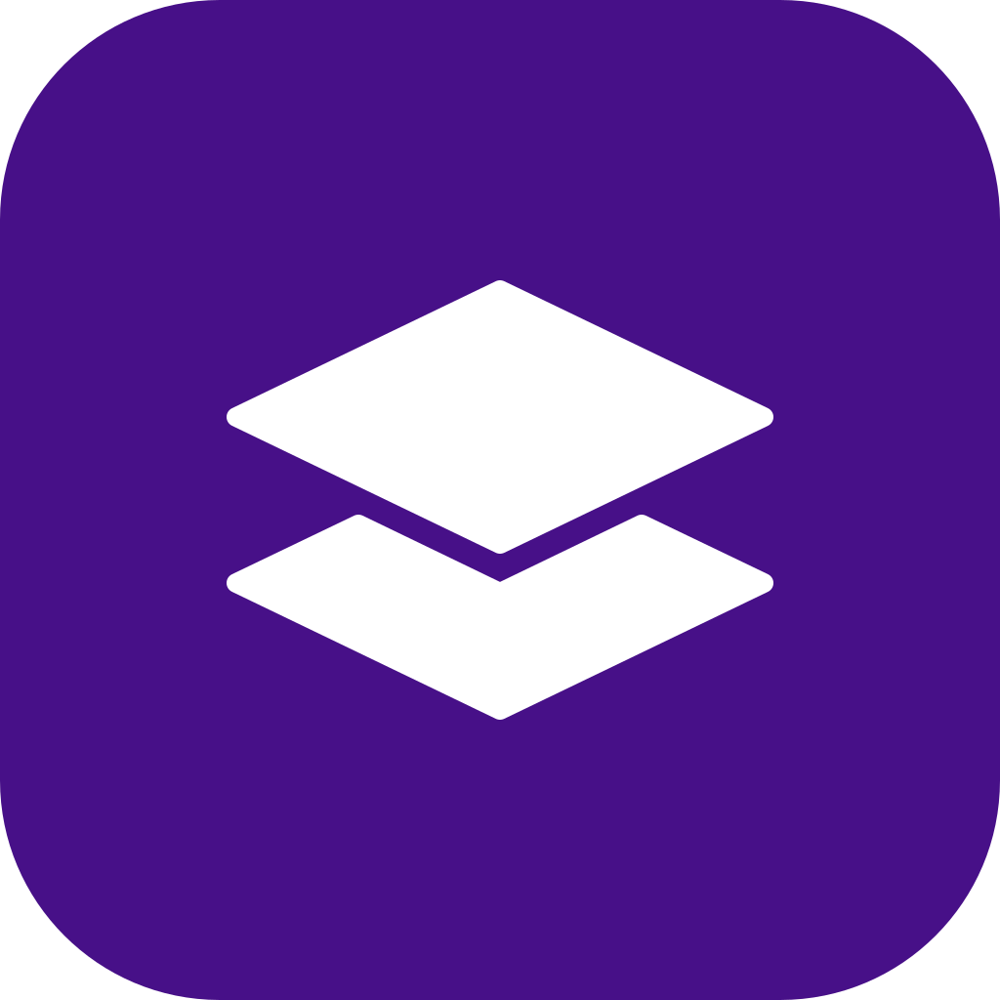

<p align="center">
  
</p>

<h1 align="center">tycoslide</h1>

<p align="center">Create editable PowerPoint slides from markdown, using your existing .pptx files as templates.</p>

<p align="center">
  <a href="https://github.com/tycoworks/tycoslide/actions/workflows/ci.yml"></a>
  <a href="https://www.npmjs.com/package/@tycoworks/tycoslide"></a>
  <a href="https://github.com/tycoworks/tycoslide#licence"></a>
</p>

tycoslide creates slides from markdown using your existing .pptx files as templates. Like [Marp](https://marp.app) or [Slidev](https://sli.dev), but with editable output. It also turns your template into an agent skill, so anyone can build on-brand decks with AI.

## Features

- **Paragraphs, bullets and numbered lists**, with bold, italic and links
- **Tables, images and speaker notes**
- **Code**, with [Shiki](https://shiki.style) syntax highlighting
- **[Mermaid](https://mermaid.js.org) diagrams**

Full syntax in [markdown.md](docs/markdown.md).

## Getting started

The [guide](docs/guide.md) walks through these three steps on your template.

1. **Create a theme.** Package your .pptx, fonts, colors, and images into a tycoslide theme. You can use the [create-theme](skills/create-theme) agent skill (`npx skills add tycoworks/tycoslide`), or clone and edit the example [tycoworks-theme](https://github.com/tycoworks/tycoworks-theme).
2. **Build your slides.** Write your slides in [markdown](docs/markdown.md), then build them into an editable PowerPoint file (`npx tycoslide build deck.md`).
3. **Package your theme as a skill.** Turn your theme into a skill (`npx tycoslide package`) and share it, so anyone on your team can build editable, on-brand slides with their agent.

## See it working

[how-it-works.md](https://github.com/tycoworks/tycoworks-theme/blob/main/how-it-works.md) is a deck about tycoslide, written against the [tycoworks-theme](https://github.com/tycoworks/tycoworks-theme). Clone the theme and build it:

```bash
git clone https://github.com/tycoworks/tycoworks-theme && cd tycoworks-theme
npm install
npx tycoslide build how-it-works.md
```

https://github.com/user-attachments/assets/f31c11d8-3fe6-464f-8f02-56645b4ce3a6

## Requirements

Node 24 or later. Mermaid diagrams need Chrome on the machine; tycoslide finds an installed one, or run `npx playwright install chromium-headless-shell`.

## Thanks

tycoslide was inspired by [pptx-automizer](https://github.com/singerla/pptx-automizer), which it uses under the hood, and by [Slidev](https://sli.dev)'s way of writing slides in markdown. You can read more about the project's background [here](https://blog.tycoworks.com/p/marketing-collateral-from-source-files).

## Licence

Dual-licensed under [MIT](LICENSE-MIT) or [Apache 2.0](LICENSE-APACHE), at your option.
